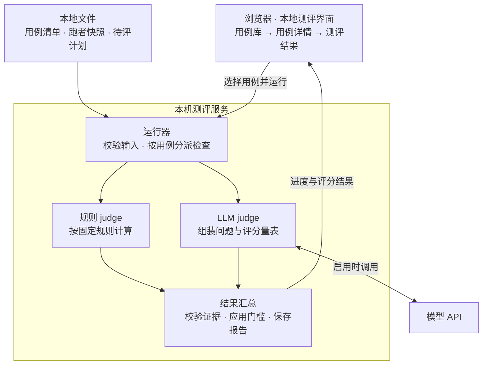
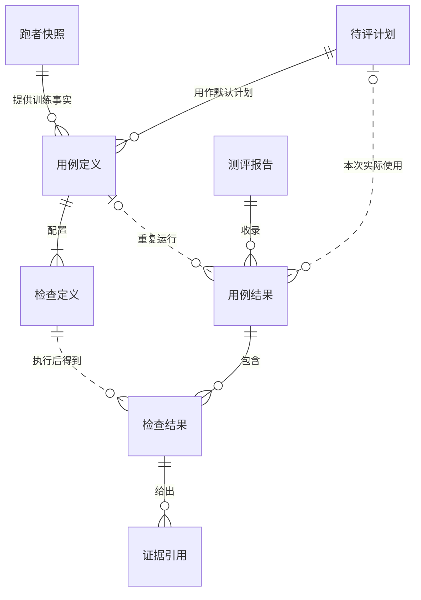

# 训练计划离线测评工具 v1

设计草案 · 2026-11-23

每个用例回答一个问题：给定跑者当时已知的训练数据和目标，这份已经写好的计划是否满足事先约定的标准？输入都来自文件；评测人员在本地 Web 界面选择用例、运行测评、查看结果；本地应用负责读取用例、执行评分、保存 JSON 报告。规则可在断网环境运行，启用 LLM 时只需访问指定的模型 API。操作流程中没有生产账号、数据库、计划生成任务或版本对比页面。

## 1. 界面与运行架构

v1 采用单用户本地 Web 应用。浏览器负责展示和交互；同机的测评服务管理文件、执行 judge、保管模型 API 凭证。应用自带计划契约。用户完成一次测评只需经过三个界面：

| 界面 | 用户看到什么 | 可以做什么 |
|---|---|---|
| 用例库 | 用例名称、周计划或总计划、启用的评分项 | 从本机导入一个用例目录或整套目录，选择一个或多个用例 |
| 用例详情 | 跑者目标、数据截止日、训练历史、训练约束、待评计划及评分标准 | 核对输入；单用例可为本次运行选择另一份计划文件；点击「运行测评」 |
| 测评结果 | 运行中显示已完成用例数；结束后显示通过、未通过、执行错误的用例数 | 展开用例查看每项分数、门槛和理由，点击证据定位到本次快照或计划的字段，导出 JSON |

导入时保留所选目录内的相对目录结构，可供多个用例共享一份快照；引用不在所选目录内时提示缺文件。运行时读取实际选择的文件，把输入副本与报告保存在本地独立的运行目录，确保以后打开报告仍能定位当时的证据。每次运行新建目录并独占创建文件，界面在保存失败时显示错误。历史报告可从结果页重新打开。v1 不需要部署数据库。



单个用例可仅启用规则、仅启用 LLM，或两者同时启用。每个已配置的检查都要执行。规则用例无需模型配置。缺少模型配置仅使对应 LLM 检查出错，同一用例仍执行规则。

新增同类案例只需添加清单、脱敏快照和待评计划。多个案例可以通过相对路径引用同一份快照。已用于评测的快照按版本保留，修正事实时新增文件并更新清单。真实数据由维护者预先整理，仅保留评测所需事实；仓库示例使用虚构数据。每次调用外部模型前须确保该用例的数据允许发送给所选服务。

## 2. 用例格式

三个输入均为 UTF-8 JSON。清单中的文件名相对于清单所在目录解析；本次替换的计划使用界面选定的文件。路径只解析本地文件。用例标识在本次套件内唯一，检查标识在用例内唯一。

**case.json**

```json
{
  "schema": "plan-eval-case/v1",
  "id": "return-week",
  "athlete": "athlete.json",
  "plan": "plan.json",
  "plan_type": "weekly",
  "checks": [
    {"id": "frequency", "kind": "rule", "rule": "weekly-run-days/v1", "min_score": 1},
    {"id": "distance", "kind": "llm", "question": "周一跑课距离与近期最长跑及本周目标是否相符？",
     "anchors": ["明显冲突", "存在较大偏差且缺少依据", "证据有限，安排尚可解释", "有训练记录支持，仅有小幅疑点", "训练记录和本周目标均明确支持"],
     "min_score": 4}
  ]
}
```

清单字段均必填，`checks` 至少一项。v1 拒绝未知字段、版本、类型和规则。规则通过带版本的名称绑定本地实现；示例规则只适用于周计划，使用其他计划类型属于用例配置错误。LLM 每项只有一个评分问题，五个非空锚点按 1 至 5 分排列。规则门槛固定为 1，LLM 门槛是 1 至 5 的整数。

**athlete.json**

```json
{
  "schema": "plan-eval-athlete/v1",
  "as_of": "2026-08-16",
  "goal": "本周轻松恢复跑，单次距离保持在近期已经完成过的范围内。",
  "constraints": {"max_run_days_per_week": 2},
  "history": [
    {"date": "2026-08-09", "fact": "过去四周最长跑为 8 公里。"}
  ]
}
```

快照必填 `schema/as_of/goal/constraints/history`。日期均为跑者当地日历日（YYYY-MM-DD）；`as_of` 表示截至该日末已知。每条历史证据含日期和非空事实，日期不得晚于截止日；数据提供者负责核对事实确为当时可见。`goal` 为非空文本。`history` 可为空，代表无记录；`constraints` 可为 {}，已有上限时填写整数 1–7。频率规则要求上限存在，缺值属于用例错误。其他事实可通过新增有日期的记录补充。

**plan.json** 保存一份原样的待评计划。清单的 `plan_type` 取 `weekly` 或 `master`，分别用本地 [WeeklyPlanSchema](../../../src/coach_contract/src/weekly_plan/schema.ts) 或 [MasterPlanSchema](../../../src/coach_contract/src/master_plan/schemas.ts) 解析。运行器可使用打包进工具的共享契约，无需加载生成器。示例计划可从[周计划契约样本](../../../tests/fixtures/weekly_plan_contract.json)提取，包含周一 8 公里轻松跑、周二力量训练和周三休息：

```sh
jq '.base' tests/fixtures/weekly_plan_contract.json > cases/return-week/plan.json
```

## 3. Judge 接口

运行器负责解析输入、选择 judge、核对输出并应用门槛。下列 TypeScript 签名表达调用边界。WeeklyPlan 和 MasterPlan 指上文对应契约的解析结果；Athlete 是上文的快照。传入 judge 的数据只读。

```ts
type Plan = {type: "weekly", value: WeeklyPlan} | {type: "master", value: MasterPlan};
type Input = {athlete: Athlete, plan: Plan};
type RuleCheck = {id: string, kind: "rule", rule: "weekly-run-days/v1", min_score: 1};
type LlmCheck = {id: string, kind: "llm", question: string, anchors: string[], min_score: number};
type Evidence = {source: "athlete" | "plan", pointer: string};
type Grade = {score: number, reason: string, evidence: Evidence[]};
type JudgeResult = {grade: Grade} | {error: {code: string, message: string}};
interface Judge<C> {
  evaluate(input: Readonly<Input>, check: Readonly<C>): Promise<JudgeResult>;
}
type RuleJudge = Judge<RuleCheck>;
type LlmJudge = Judge<LlmCheck>;
```

- **规则 judge** 对 `weekly-run-days/v1` 取该周 `sessions` 中 `kind=run` 的不同日期数，同日两跑计一天。实际天数小于等于上限得 1 分，否则得 0 分。理由给出实测值和上限，证据定位至快照约束与计划排课。规则只读本地输入。
- **LLM judge** 每个检查调用一次模型 API。适配器使用版本化提示词，把快照、计划、问题和五档量表传给模型。快照及计划作为待分析数据传入。模型返回一个 Grade JSON，不接收其他检查的结论；门槛由运行器使用。服务名、模型名从运行配置注入，密钥通过环境变量或密钥管理器提供。
- **共同约束**：分数为该 judge 量表内整数，理由非空。至少一条证据；LLM 评分须各引用一条跑者和计划证据。指针用 RFC 6901 JSON Pointer，基于对应输入文档的根，必须能解析；可引用空数组表达缺少记录。API 超时、鉴权失败、模型输出格式错误、指针不存在或 judge 异常均产生执行错误。v1 单次尝试，继续其余检查。评分完成时 `score >= min_score` 即通过。

## 4. 报告格式与界面状态

示例对应上面的用例。模型名称及评分用于说明报告格式。三个 SHA-256 对应示例文件的实际字节（两个内嵌 JSON 块含末尾换行，计划使用上文 jq 命令导出）。

```json
{
  "schema": "plan-eval-report/v1",
  "runner_version": "0.1.0",
  "status": "pass",
  "summary": {"pass": 1, "fail": 0, "error": 0},
  "errors": [],
  "cases": [{
    "manifest": "return-week/case.json",
    "case_id": "return-week",
    "inputs_sha256": {"manifest": "53bcdeaf2a40229184d8c644b5208f100407c9272d7a8bf2ff6f70760f05a4f6", "athlete": "118ee39e356b4a93e1f5f60ad1b09513c02ee0844b5b7bcc2efac291aed6c436", "plan": "a12d6ca3125fc0821704c42121ce645bfa2348d27660b0dada3bb5bb1715c619"},
    "status": "pass",
    "errors": [],
    "checks": [
      {"id": "frequency", "kind": "rule", "judge": {"rule": "weekly-run-days/v1"},
       "status": "pass", "score": 1, "min_score": 1, "reason": "1 个跑步日，上限 2 天。",
       "evidence": [{"source": "athlete", "pointer": "/constraints/max_run_days_per_week"}, {"source": "plan", "pointer": "/sessions"}]},
      {"id": "distance", "kind": "llm", "judge": {"provider": "example", "model": "example-model", "prompt_version": "plan-grade/v1"},
       "status": "pass", "score": 5, "min_score": 4, "reason": "周一为 8 公里轻松跑，与近四周最长跑相同，符合本周目标。",
       "evidence": [{"source": "athlete", "pointer": "/history/0/fact"}, {"source": "athlete", "pointer": "/goal"}, {"source": "plan", "pointer": "/sessions/0"}]}
    ]
  }]
}
```

- `manifest` 为相对发现根目录的路径。单用例直接指向用例目录时值为 `case.json`。`inputs_sha256` 对实际读取的字节取小写十六进制摘要，在界面替换待评计划时记录替换后的计划。规则版本、模型请求标识和提示词版本用于追溯；模型 API 的同配置重跑可能有波动。
- 已评分的检查完整保留分数、门槛、理由和证据。检查执行错误时保留标识、kind、judge、门槛，置 `status="error", score=null, evidence=[]`，以 `error:{code,message}` 替代 reason。错误信息经过脱敏；报告省略凭证、原始提示词和模型原始响应。
- 清单、快照或输入文件读取错误记在用例的 `errors`（元素均为 `{code,message}`），该用例的 `checks=[]`，继续其他有效用例。无法取得的 case_id 或哈希用 null。文件可读但候选计划不是合法 JSON 或未通过所声明计划的契约校验，视为候选产物失败，记用例 `fail`，`errors` 记录 `invalid_plan`，跳过该用例所有 judge。先验证清单与快照，确保不会把输入配置错误算在候选头上。
- 用例内、套件内均按 **error > fail > pass** 汇总，保留各检查原始状态；所有检查均为必过项。summary 按用例最终状态计数。空套件、重复用例 ID 或批量覆盖计划等全局配置错误，在顶层 errors 报告并结束，cases 为空，计数均为零。界面分别显示「通过」「未通过」「执行错误」。运行中为临时展示状态；报告无法保存时，界面明确标记「保存失败」。

例如，混合用例中模型服务和模型名均未配置时，该检查的报告记录如下；频率规则仍保留自己的分数。

```json
{"id":"distance","kind":"llm","judge":{"provider":null,"model":null,"prompt_version":"plan-grade/v1"},
 "status":"error","score":null,"min_score":4,"evidence":[],
 "error":{"code":"model_config_missing","message":"缺少模型服务和模型名。"}}
```

## 5. 用例与运行结果的实体关系

下图表示文件和报告内对象的逻辑关系。用例清单描述可重复运行的测试条件；一次运行产生一份报告。用例结果记录本次真正使用的输入，支持临时替换计划。图中实体名称描述对象的职责，JSON 的字段名以上文示例为准。



读图示例：同一个「恢复跑」用例可以先评默认计划 A，再评临时导入的计划 B。两次报告引用同一跑者快照和检查定义，各自保存实际计划的哈希和输入副本。检查结果中的证据用 `source + JSON Pointer` 定位到对应副本。清单或计划读取失败时仍可生成用例结果，因此它与有效用例定义、实际计划的关联均允许缺失。执行错误可以没有分数和证据。

## 6. 实现验收

| 操作 | 可观察结果 |
|---|---|
| 仅配置频率规则，移除模型凭证并断网 | 示例通过；再加两个不同日期的跑课，达到 3 个跑步日，分数从 1 变为 0；同日双跑只计一天 |
| 从界面导入用例，临时替换计划，执行后重新打开报告并点击证据 | 定位到本次使用的输入字段，原用例和已有报告保持完整 |
| 仅配置 LLM，测试适配器依次返回带有效证据的 3 分和 4 分 | 门槛为 4 时分别 fail、pass；适配器收到该用例的快照、候选计划和量表 |
| 同时配置两种 judge，让规则失败、LLM 通过 | 用例 fail，报告保留两项分数；替换输入只影响本次报告 |
| 注入 API 超时、缺失证据指针、缺文件、损坏的候选计划 | 前三种 error，损坏计划 fail；批量继续执行后续有效用例 |
| 复制用例并换成新的唯一 ID 和快照 | 一次运行报告两个用例，无需改运行器或 judge |
| 使用允许发给外部服务的虚构用例及已配置的模型 API | 单独验证鉴权和结构化输出，报告记录服务和模型；日常契约测试可使用固定 API 响应 |
