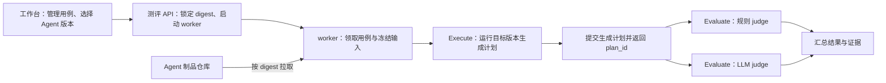
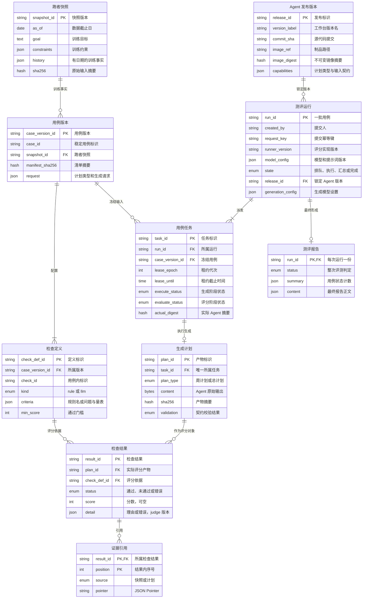

# 训练计划分布式离线测评平台 v1

设计草案 · 2026-11-23 · [查看架构图和实体属性图](2026-11-23-plan-eval-diagrams.html)

评测对象是工作台选定的 **Coach Agent 发布版本**。每个用例先执行该版本生成计划（Execute），再对已经保存的同一份计划进行规则和 LLM 评分（Evaluate）。测评使用冻结的用户数据；生成和评分都在独立测评环境内运行。生成模型与评分模型可以分别调用获准的模型 API。

## 1. 工作台与分布式服务

| 工作台入口 | 用户操作 | 平台记录 |
|---|---|---|
| 用例库 | 查看、新建、导入和修改用例。选择或填写脱敏快照，指定生成请求、计划类型和检查标准 | 首次保存创建用例；编辑保存为新版本，旧运行继续引用原版本。并发编辑冲突时提示重新加载 |
| 发起测评 | 选择一个 Coach Agent 版本和一个或多个用例，确认生成模型及评分配置，点击「运行测评」 | 展示版本标签与提交号，提交后返回 run_id。换版本再测会创建新的运行 |
| 运行详情 | 查看每个用例的 Execute 和 Evaluate 进度；打开生成的计划、两路评分、证据或失败原因 | 记录目标及实际执行的制品摘要、输入版本、生成计划 ID 和内容摘要。浏览器关闭后任务继续 |
| 历史报告 | 通过运行 ID 查看或导出结果，从证据跳到冻结快照或生成计划的具体字段 | 每次运行保留自己的计划和报告 |

用例可通过表单直接维护，也可导入包含 case.json、快照及其引用数据的目录。API 只解析上传目录内的引用；保存前校验、保留原始字节并计算摘要。已有标识须明确保存为新版本。维护者可以复用快照；编辑快照生成新版本。新版本的 Coach Agent 对相同用例重新生成计划。

工作台内的「新建」表单填写跑者目标、截止日与历史事实，也可选择已有快照；随后填写生成请求、规则、评分问题、五档量表与门槛。导入前预览各项输入及校验错误。详情页可切换历史版本，逐项核对输入和评分标准；详情页与新建表单共用编辑器。创建和修改用例都不需要预先提供一份候选计划。

### 提交、Execute、Evaluate

1. **提交与启动。** Agent 发布时将可执行制品和版本信息登记到版本目录。建议用 OCI 镜像承载真实 Agent 代码、提示词、资源和离线执行入口；版本记录包含标签、提交号、镜像地址及不可变 digest。API 把选择解析为 digest，在同一事务保存运行、冻结的用例版本、生成/评分配置及待启动任务。提交幂等键关联同一 run_id。API 的调度器根据持久化任务请求集群启动 worker；中断后扫描待启动任务并补调度，多副本按任务租约仲裁。
2. **Execute · 拉取与生成。** worker 领取用例任务后按运行锁定的 digest 自动拉取或命中已校验的镜像缓存，核对实际 digest 后运行该版 Coach Agent。测评适配器把生成请求、固定时钟和冻结的只读数据提供给真实的计划生成入口；其数据读取限于用例所含资料。运行不使用生产用户凭证、在线计划生成服务或生产写入接口。Agent 需要额外历史记录、目标或既有周计划上下文时，应随用例固化；缺失时显式报错。评分问题和量表只对 Evaluate 可见。
3. **Execute · 保存产物。** worker 经内部 API 保存 Agent 输出原始字节、类型、SHA-256、任务 ID 和实际镜像 digest。按本地共享计划契约校验。有效产物与任务的「可评分」状态在一个事务内提交；此后才允许领取 Evaluate 工作。候选输出不符合契约时保留原始输出与错误路径，记为产物未通过，跳过评分。拉取失败、digest 不符、进程异常或没有输出时记 Execute 执行错误。
4. **Evaluate · 两路评分。** worker 按 plan_id 读取已保存的产物并核对摘要。规则 judge 运行固定检查；LLM judge 读取同一份计划与快照，按量表评分。新建用例默认提供规则和 LLM 两类评分项。两路独立，可并行；每个启用的检查分别落分，单路出错保留另一条结果。同时配置两类检查的用例执行两路；只配置一种的用例执行已声明的检查。生成与评分使用各自的模型配置和凭证。
5. **接管与报告。** 以租约代次拒绝迟到写回，每个任务至多提交一个计划。持久化前中断可能需要再次执行 Agent；持久化成功后接管仅恢复 Evaluate，复用同一 plan_id 并跳过已提交的检查。进程崩溃时外部模型调用可能重复，数据库按产物和检查键去重。所有用例终结后 API 幂等保存最终报告，界面显示每个阶段的状态、质量结论和证据。

最小部署建议沿用独立测评 MySQL 存放版本、冻结输入、任务队列、计划原文和报告，Go 测评 API 的 storage 层拥有写入；worker 通过内部 API 领取、续租和提交。集群负责启动 worker，制品仓库负责分发已发布版本。具体容器平台和可并发的 worker 数量留给部署阶段。首次接入需为目标版本发布离线执行入口并验证周计划或总计划能力；版本目录只展示具备相应能力的可执行版本。



## 2. 用例输入与生成产物

**用例输入**为 UTF-8 JSON 清单和脱敏快照。生成请求保存在清单内；judge 定义由调度器剔除后才向 Agent 传入生成输入。用例 ID 在套件内唯一，检查 ID 在用例内唯一。

**case.json**

```json
{
  "schema": "plan-eval-case/v1",
  "id": "return-week",
  "athlete": "athlete.json",
  "request": {"instruction": "根据跑者目标制定下周训练计划。", "start_date": "2026-08-17"},
  "plan_type": "weekly",
  "checks": [
    {"id": "frequency", "kind": "rule", "rule": "weekly-run-days/v1", "min_score": 1},
    {"id": "distance", "kind": "llm", "question": "周一跑课距离与近期最长跑及本周目标是否相符？",
     "anchors": ["明显冲突", "存在较大偏差且缺少依据", "证据有限，安排尚可解释", "有训练记录支持，仅有小幅疑点", "训练记录和本周目标均明确支持"],
     "min_score": 4}
  ]
}
```

request.instruction 为非空文本，start_date 为目标起始日，as_of 使用快照截止日。清单字段均必填，`checks` 至少一项。v1 拒绝未知字段、版本、类型和规则。规则通过带版本的名称绑定本地实现；示例规则只适用于周计划，使用其他计划类型属于用例配置错误。LLM 每项只有一个评分问题，五个非空锚点按 1 至 5 分排列。规则门槛固定为 1，LLM 门槛是 1 至 5 的整数。

**athlete.json**

```json
{
  "schema": "plan-eval-athlete/v1",
  "as_of": "2026-08-16",
  "goal": "本周轻松恢复跑，单次距离保持在近期已经完成过的范围内。",
  "constraints": {"max_run_days_per_week": 2},
  "history": [
    {"date": "2026-08-09", "fact": "过去四周最长跑为 8 公里。"}
  ]
}
```

快照必填 `schema/as_of/goal/constraints/history`。日期均为跑者当地日历日（YYYY-MM-DD）；`as_of` 表示截至该日末已知。每条历史证据含日期和非空事实，日期不得晚于截止日；数据提供者负责核对事实确为当时可见。`goal` 为非空文本。`history` 可为空，代表无记录；`constraints` 可为 {}，已有上限时填写整数 1–7。频率规则要求上限存在，缺值属于用例错误。其他事实可通过新增有日期的记录补充。

**生成产物**由 Execute 输出。`plan_type` 为 weekly 或 master，分别通过 [WeeklyPlanSchema](../../../src/coach_contract/src/weekly_plan/schema.ts) 或 [MasterPlanSchema](../../../src/coach_contract/src/master_plan/schemas.ts) 校验。执行入口按版本接受「计划类型、生成请求、冻结数据、时钟、生成模型配置」，产生一份计划原文或结构化执行错误。第一版可在隔离适配器中复用 [Coach Agent 核心包](../../../src/coach_agent/package.json)，并以冻结数据实现该版本所需的数据读取接口。平台需要已有训练活动等结构化记录的地方，按版本输入契约校验，不能从文字摘要补造。

下方报告使用仓库[周计划样本](../../../tests/fixtures/weekly_plan_contract.json)的 base 对象模拟一次成功输出，以便校验字段和证据路径。该样本仅用于文档验证。

## 3. Judge 接口

运行器负责解析输入、选择 judge、核对输出并应用门槛。下列 TypeScript 签名表达调用边界。WeeklyPlan 和 MasterPlan 指上文对应契约的解析结果；Athlete 是上文的快照。传入 judge 的数据只读。

```ts
type Plan = {type: "weekly", value: WeeklyPlan} | {type: "master", value: MasterPlan};
type Input = {athlete: Athlete, plan: Plan};
type RuleCheck = {id: string, kind: "rule", rule: "weekly-run-days/v1", min_score: 1};
type LlmCheck = {id: string, kind: "llm", question: string, anchors: string[], min_score: number};
type Evidence = {source: "athlete" | "plan", pointer: string};
type Grade = {score: number, reason: string, evidence: Evidence[]};
type JudgeResult = {grade: Grade} | {error: {code: string, message: string}};
interface Judge<C> {
  evaluate(input: Readonly<Input>, check: Readonly<C>): Promise<JudgeResult>;
}
type RuleJudge = Judge<RuleCheck>;
type LlmJudge = Judge<LlmCheck>;
```

- **规则 judge** 对 `weekly-run-days/v1` 取该周 `sessions` 中 `kind=run` 的不同日期数，同日两跑计一天。实际天数小于等于上限得 1 分，否则得 0 分。理由给出实测值和上限，证据定位至快照约束与计划排课。规则只读本次任务的冻结输入。
- **LLM judge** 每个检查调用一次模型 API。适配器使用版本化提示词，把快照、计划、问题和五档量表传给模型。快照及计划作为待分析数据传入。模型返回一个 Grade JSON，不接收其他检查的结论；门槛由运行器使用。服务名、模型名从运行配置注入，密钥通过环境变量或密钥管理器提供。
- **共同约束**：分数为该 judge 量表内整数，理由非空。至少一条证据；LLM 评分须各引用一条跑者和计划证据。指针用 RFC 6901 JSON Pointer，基于对应输入文档的根，必须能解析；可引用空数组表达缺少记录。API 超时、鉴权失败、模型输出格式错误、指针不存在或 judge 异常均产生执行错误。一次正常执行中每项调用一次；错误写回后继续其余检查。中断接管按上文处理。评分完成时 `score >= min_score` 即通过。

## 4. 报告格式与界面状态

以下为示意报告；版本、镜像、模型和运行标识均为虚构值。输入摘要取两个 JSON 文本块含末尾换行的字节；产物摘要取周计划样本经 `jq '.base'` 导出的字节。

```json
{
  "schema": "plan-eval-report/v1",
  "run_id": "run-001",
  "runner_version": "0.1.0",
  "status": "pass",
  "summary": {
    "pass": 1,
    "fail": 0,
    "error": 0
  },
  "errors": [],
  "cases": [
    {
      "task_id": "task-001",
      "manifest": "return-week/case.json",
      "case_id": "return-week",
      "inputs_sha256": {
        "manifest": "24017f40a66b3d03ad1f3acba253b8535de86d26d5d53566ccc6391e0dad5523",
        "athlete": "118ee39e356b4a93e1f5f60ad1b09513c02ee0844b5b7bcc2efac291aed6c436"
      },
      "status": "pass",
      "errors": [],
      "checks": [
        {
          "id": "frequency",
          "kind": "rule",
          "judge": {
            "rule": "weekly-run-days/v1"
          },
          "status": "pass",
          "score": 1,
          "min_score": 1,
          "reason": "1 个跑步日，上限 2 天。",
          "evidence": [
            {
              "source": "athlete",
              "pointer": "/constraints/max_run_days_per_week"
            },
            {
              "source": "plan",
              "pointer": "/sessions"
            }
          ]
        },
        {
          "id": "distance",
          "kind": "llm",
          "judge": {
            "provider": "example",
            "model": "example-model",
            "prompt_version": "plan-grade/v1"
          },
          "status": "pass",
          "score": 5,
          "min_score": 4,
          "reason": "周一为 8 公里轻松跑，与近四周最长跑相同，符合本周目标。",
          "evidence": [
            {
              "source": "athlete",
              "pointer": "/history/0/fact"
            },
            {
              "source": "athlete",
              "pointer": "/goal"
            },
            {
              "source": "plan",
              "pointer": "/sessions/0"
            }
          ]
        }
      ],
      "case_version_id": "case-v1",
      "execute": {
        "status": "pass",
        "actual_digest": "sha256:abababababababababababababababababababababababababababababababab",
        "plan_id": "plan-001",
        "plan_sha256": "a12d6ca3125fc0821704c42121ce645bfa2348d27660b0dada3bb5bb1715c619"
      },
      "evaluate": {
        "status": "pass",
        "plan_id": "plan-001"
      }
    }
  ],
  "agent": {
    "version": "example-v2",
    "commit": "aaaaaaaaaaaaaaaaaaaaaaaaaaaaaaaaaaaaaaaa",
    "digest": "sha256:abababababababababababababababababababababababababababababababab"
  },
  "generation_model": "example-generator"
}
```

- run_id 标识一次版本测评，case_version_id 标识冻结用例。execute 记录实际运行的 digest 和生成产物；evaluate.plan_id 必须等于 execute.plan_id。生成及评分模型的调用可能有波动，持久化产物支持复查当时的评分。
- 阶段在界面上可处于 queued、running；报告记录终态 pass、fail、error 或 skipped。Execute 返回无效产物为 fail，基础设施异常为 error；上述两种情况 Evaluate 都为 skipped，checks 为空。未拉起 Agent 时 actual_digest 为空；未获得持久化产物时 plan_id、plan_sha256 均为空。
- Evaluate 每个检查输出分数、门槛、理由、证据；执行错误保留 judge 信息、门槛、空证据和错误码，score 为 null。用例和整批按 error > fail > pass 汇总，skipped 不覆盖前序失败。终态报告按用例计数，运行中在界面显示真实阶段。报告保存失败时提示待重试。

例如，混合用例中模型服务和模型名均未配置时，该检查的报告记录如下；频率规则仍保留自己的分数。

```json
{"id":"distance","kind":"llm","judge":{"provider":null,"model":null,"prompt_version":"plan-grade/v1"},
 "status":"error","score":null,"min_score":4,"evidence":[],
 "error":{"code":"model_config_missing","message":"缺少模型服务和模型名。"}}
```

## 5. 用例与运行结果的实体关系

下图给出平台的逻辑实体、主要属性、标识和基数。PK 表示主键，FK 表示关联键。快照与清单保留上传时的原始字节，校验时按原始字节而非 JSON 再序列化结果计算摘要。JSON 报告是对已完成运行的导出视图。



一次运行锁定一个 Agent 版本。每个用例任务绑定一个冻结用例，执行后至多关联一份原始计划。实际 digest 与任务所属运行的目标 digest 必须相等；每个检查结果唯一键为 (plan_id, check_def_id)，且检查须来自该任务的用例版本。证据的 athlete 指向冻结快照，plan 指向结果关联的产物。非法产物仍可查阅，但不会有检查结果。运行终结后生成一份报告。

## 6. 实现验收

| 场景 | 可验证结果 |
|---|---|
| 在工作台创建、导入、查看、修改用例 | 新版本保留生成请求、输入快照和检查定义，历史运行仍引用原版本 |
| 同一用例分别选择 Agent A、B | 两次运行各自启动 worker，按锁定 digest 拉取对应版本；可查两个任务各自生成的计划、摘要及双路结果，即使计划内容相同也能区分来源 |
| 拉取镜像失败、digest 不符或 Agent 无输出 | Execute 为 error，Evaluate 为 skipped，两个 judge 均无调用 |
| Agent 输出不符合计划契约 | 保留原输出，Execute 为 fail，报告指出校验路径，两路评分均跳过 |
| 在产物提交前阻塞写入；提交后中断 worker | 提交前两个 judge 的调用数均为零；接管时复用已保存的 plan_id，无第二次生成 |
| 规则评分失败，LLM 通过；另一次注入模型超时 | 分别呈现两路结果、证据与状态；LLM 故障保留规则得分 |
| 两台 worker 执行不同用例，关闭浏览器后重开 | 通过 run_id 查看 Execute、Evaluate、计划原文及报告；迟到写回不会产生第二份计划或评分 |
