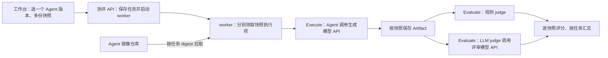
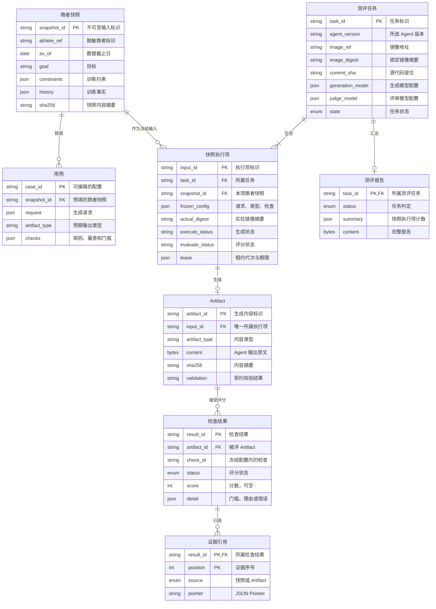

# 训练计划分布式离线测评平台 v1

设计草案 · 2026-11-23 · [查看架构图和实体属性图](2026-11-23-plan-eval-diagrams.html)

一次**测评任务**选择一个 Coach Agent 版本和一份或多份跑者快照。例如，选中同一版本和三位跑者的数据，平台建立一个任务、三个独立的快照执行项。每项分别调用生成模型、保存 Artifact、执行双路评分；任务报告汇总三项结果。训练计划是 v1 支持的 Artifact 类型。

## 1. 工作台与分布式服务

| 工作台入口 | 用户操作 | 平台记录 |
|---|---|---|
| 用例库 | 查看、新建、导入、修改用例，维护脱敏快照、请求、预期 Artifact 类型和评分标准 | 用例可直接编辑。新建快照后可供多个用例和任务引用 |
| 发起测评 | 选择 Agent 版本和一份或多份跑者快照，确认每份快照的生成请求、规则、量表及门槛。也可从用例预填 | 创建一个 task_id。任务自身保存 Agent 版本标签、提交号、镜像地址与不可变 digest，以及生成和评审模型配置 |
| 任务详情 | 逐跑者查看 Execute、Evaluate、Artifact、分数和证据 | 显示输入快照、实际执行的 digest、Artifact 类型与摘要。关闭浏览器后任务继续执行 |
| 历史报告 | 按任务打开或导出，查看汇总和每份快照的原始结果 | 同一批快照换 Agent 版本再测时生成新任务，可分别回看 |

用例是一条可编辑的配置。表单与目录导入使用同一契约；导入前预览快照和检查，并提示缺失引用。编辑已共享的跑者数据时保存一份新快照并更新用例的引用。提交测评时，把当时的请求与检查配置复制到快照执行项中。之后修改用例，只影响下一次提交。直接选择快照时在工作台填写相同的配置。

### 提交、Execute、Evaluate

1. **提交。** 工作台从 Agent 镜像仓库的发布信息展示可选版本。测评 API 将所选版本解析为不可变 digest，将版本信息写入测评任务。一次事务保存任务和全部快照执行项，要求至少一份快照；同一次请求重发取回原 task_id。调度器据已持久化的执行项请求集群启动 worker，可以并行处理不同跑者。
2. **Execute 调用生成模型。** worker 经内部 API 领取一项，按任务 digest 拉取真实 Agent 或使用已核验的缓存。核对实际 digest，载入这一项的冻结快照、请求和时钟，运行 Coach Agent **调用生成模型 API**。worker 只向 Agent 提供该跑者的数据；评分量表由 Evaluate 使用。生成模型配置与 LLM judge 模型配置分别保存，凭证由服务端注入。
3. **保存 Artifact。** worker 捕获输出原始字节，按 artifact_type 选择契约校验，连同类型、内容摘要和 input_id 一并持久化。对有效输出，Artifact 保存与该项切换到可评分状态同事务提交。若输出不符合契约则保存原文与校验错误并跳过评分；模型调用失败且无输出则记录 Execute 错误，其他跑者的执行项可以继续。
4. **Evaluate 双路评分。** worker 按 artifact_id 读取并核验已提交的 Artifact。规则 judge 运行固定检查；LLM judge **调用评审模型 API**，依据同一份 Artifact、对应跑者快照和冻结量表打分。两路独立，各自持久化分数、理由和证据，单路失败保留另一条结果。默认同时提供两类检查，也支持仅启用其中一类。
5. **接管与汇总。** 每个快照执行项有独立租约，拒绝过期租约写回。v1 每个执行项至多保存一个 Artifact。保存前中断可能再次调用生成模型；保存后接管者只恢复未完成的评分。结果在 (artifact_id, check_id) 上去重。所有执行项结束后按 task_id 幂等保存一份任务报告。

平台可用独立测评 MySQL 保存任务、输入、Artifact 原文和结果，Go API 的 storage 层负责写入。worker 通过内部 API 领取、续租和提交。任务自带快照，整个流程独立于生产数据库和在线计划生成服务。部署时必须配置生成模型 API；启用 LLM judge 时还需配置评审模型 API。



## 2. 输入与 Artifact

**工作台提交示例**（两个 snapshot_id 分别对应两位跑者）。选取用例时，以其当时的配置预填；直接选取快照时，由界面提交 request、artifact_type 和 checks。API 在提交时解析出完整输入并冻结。清单中的 schema 字段表示文件格式。

```json
{"agent_version":"example-v2","generation_model":"example-generator","judge_model":"example-judge",
 "inputs":[{"snapshot_id":"snapshot-a","case_id":"return-week"},{"snapshot_id":"snapshot-b","case_id":"return-week-b"}]}
```

以下为可从界面导入或编辑的一条用例配置。清单引用与所选快照须相符，检查 ID 在该配置内唯一。

**case.json**

```json
{
  "schema": "plan-eval-case/v1",
  "id": "return-week",
  "athlete": "athlete.json",
  "request": {"instruction": "根据跑者目标制定下周训练计划。", "start_date": "2026-08-17"},
  "artifact_type": "weekly_plan",
  "checks": [
    {"id": "frequency", "kind": "rule", "rule": "weekly-run-days/v1", "min_score": 1},
    {"id": "distance", "kind": "llm", "question": "周一跑课距离与近期最长跑及本周目标是否相符？",
     "anchors": ["明显冲突", "存在较大偏差且缺少依据", "证据有限，安排尚可解释", "有训练记录支持，仅有小幅疑点", "训练记录和本周目标均明确支持"],
     "min_score": 4}
  ]
}
```

request.instruction 为非空文本，start_date 为目标起始日，as_of 使用快照截止日。清单字段均必填，`checks` 至少一项。v1 拒绝未知字段、版本、类型和规则。规则通过带版本的名称绑定本地实现；示例规则只适用于周计划，使用其他计划类型属于用例配置错误。LLM 每项只有一个评分问题，五个非空锚点按 1 至 5 分排列。规则门槛固定为 1，LLM 门槛是 1 至 5 的整数。

**athlete.json**

```json
{
  "schema": "plan-eval-athlete/v1",
  "as_of": "2026-08-16",
  "goal": "本周轻松恢复跑，单次距离保持在近期已经完成过的范围内。",
  "constraints": {"max_run_days_per_week": 2},
  "history": [
    {"date": "2026-08-09", "fact": "过去四周最长跑为 8 公里。"}
  ]
}
```

快照必填 `schema/as_of/goal/constraints/history`。导入时记录脱敏跑者标识 athlete_ref。日期均为上海日历日（YYYY-MM-DD）；`as_of` 表示截至该日末已知。每条历史证据含日期和非空事实，日期不得晚于截止日；数据提供者负责核对事实确为当时可见。`goal` 为非空文本。`history` 可为空，代表无记录；`constraints` 可为 {}，已有上限时填写整数 1–7。频率规则要求上限存在，缺值属于用例错误。其他事实可通过新增有日期的记录补充。

**生成产物**统一存为 Artifact。v1 的 `artifact_type` 支持 weekly_plan、master_plan，分别通过 [WeeklyPlanSchema](../../../src/coach_contract/src/weekly_plan/schema.ts) 或 [MasterPlanSchema](../../../src/coach_contract/src/master_plan/schemas.ts) 校验。执行入口按版本接受「Artifact 类型、生成请求、冻结数据、时钟、生成模型配置」，产生一份 Artifact 原文或结构化执行错误。第一版可在隔离适配器中复用 [Coach Agent 核心包](../../../src/coach_agent/package.json)，并以冻结数据实现该版本所需的数据读取接口。平台需要已有训练活动等结构化记录的地方，按版本输入契约校验，不能从文字摘要补造。

下方报告使用仓库[周计划样本](../../../tests/fixtures/weekly_plan_contract.json)的 base 对象模拟一次成功输出，以便校验字段和证据路径。该样本仅用于文档验证。

## 3. Judge 接口

运行器负责解析输入、选择 judge、核对输出并应用门槛。下列 TypeScript 签名表达调用边界。WeeklyPlan 和 MasterPlan 指上文对应契约的解析结果；Athlete 是上文的快照。传入 judge 的数据只读。

```ts
type Artifact = {id: string} & (
  {type: "weekly_plan", value: WeeklyPlan} | {type: "master_plan", value: MasterPlan}
);
type Input = {athlete: Athlete, artifact: Artifact};
type RuleCheck = {id: string, kind: "rule", rule: "weekly-run-days/v1", min_score: 1};
type LlmCheck = {id: string, kind: "llm", question: string, anchors: string[], min_score: number};
type Evidence = {source: "athlete" | "artifact", pointer: string};
type Grade = {score: number, reason: string, evidence: Evidence[]};
type JudgeResult = {grade: Grade} | {error: {code: string, message: string}};
interface Judge<C> {
  evaluate(input: Readonly<Input>, check: Readonly<C>): Promise<JudgeResult>;
}
type RuleJudge = Judge<RuleCheck>;
type LlmJudge = Judge<LlmCheck>;
```

- **规则 judge** 对 `weekly-run-days/v1` 取该周 `sessions` 中 `kind=run` 的不同日期数，同日两跑计一天。实际天数小于等于上限得 1 分，否则得 0 分。理由给出实测值和上限，证据定位至快照约束与计划排课。规则从该快照执行项读取上限，从 Artifact 读取训练日。新增内容类型时扩展类型、校验器及适用的检查。
- **LLM judge** 每个检查调用一次模型 API。适配器使用版本化提示词，把快照、Artifact 内容、问题和五档量表传给评审模型。快照及 Artifact 作为待分析数据传入。模型返回一个 Grade JSON，不接收其他检查的结论；门槛由运行器使用。服务名、模型名从运行配置注入，密钥通过环境变量或密钥管理器提供。
- **共同约束**：分数为该 judge 量表内整数，理由非空。至少一条证据；LLM 评分须各引用一条跑者和计划证据。指针用 RFC 6901 JSON Pointer，基于对应输入文档的根，必须能解析；可引用空数组表达缺少记录。API 超时、鉴权失败、模型输出格式错误、指针不存在或 judge 异常均产生执行错误。一次正常执行中每项调用一次；错误写回后继续其余检查。中断接管按上文处理。评分完成时 `score >= min_score` 即通过。

## 4. 报告格式与界面状态

报告按任务汇总，按快照执行项展开。下例中，同一 Agent 为第一位跑者生成并评完周计划，第二位跑者在 Execute 调用模型 API 时超时。两位跑者各自的结果均被保留。版本与模型标识均为示意值；第一份 Artifact 的摘要对应周计划样本经 `jq '.base'` 导出的字节。

```json
{
  "schema": "plan-eval-report/v1",
  "task_id": "task-001",
  "agent_version": "example-v2",
  "image_ref": "example/coach",
  "image_digest": "sha256:abababababababababababababababababababababababababababababababab",
  "commit_sha": "aaaaaaaaaaaaaaaaaaaaaaaaaaaaaaaaaaaaaaaa",
  "runner_version": "0.1.0",
  "generation_model": "example-generator",
  "judge_model": "example-judge",
  "status": "error",
  "summary": {
    "pass": 1,
    "fail": 0,
    "error": 1
  },
  "inputs": [
    {
      "input_id": "input-a",
      "snapshot_id": "snapshot-a",
      "status": "pass",
      "execute": {
        "status": "pass",
        "actual_digest": "sha256:abababababababababababababababababababababababababababababababab",
        "artifact_id": "art-a",
        "artifact_type": "weekly_plan",
        "sha256": "a12d6ca3125fc0821704c42121ce645bfa2348d27660b0dada3bb5bb1715c619"
      },
      "evaluate": {
        "status": "pass",
        "artifact_id": "art-a",
        "checks": [
          {
            "id": "frequency",
            "kind": "rule",
            "judge": {
              "rule": "weekly-run-days/v1"
            },
            "status": "pass",
            "score": 1,
            "min_score": 1,
            "reason": "1 个跑步日，上限 2 天。",
            "evidence": [
              {
                "source": "athlete",
                "pointer": "/constraints/max_run_days_per_week"
              },
              {
                "source": "artifact",
                "pointer": "/sessions"
              }
            ]
          },
          {
            "id": "distance",
            "kind": "llm",
            "judge": {
              "provider": "example",
              "model": "example-judge",
              "prompt_version": "plan-grade/v1"
            },
            "status": "pass",
            "score": 5,
            "min_score": 4,
            "reason": "周一为 8 公里轻松跑，与近四周最长跑相同，符合本周目标。",
            "evidence": [
              {
                "source": "athlete",
                "pointer": "/history/0/fact"
              },
              {
                "source": "athlete",
                "pointer": "/goal"
              },
              {
                "source": "artifact",
                "pointer": "/sessions/0"
              }
            ]
          }
        ]
      }
    },
    {
      "input_id": "input-b",
      "snapshot_id": "snapshot-b",
      "status": "error",
      "execute": {
        "status": "error",
        "actual_digest": "sha256:abababababababababababababababababababababababababababababababab",
        "artifact_id": null,
        "error": {
          "code": "generation_model_timeout",
          "message": "生成模型调用超时。"
        }
      },
      "evaluate": {
        "status": "skipped",
        "artifact_id": null,
        "checks": []
      }
    }
  ]
}
```

- task_id 直接定位一次测评。每项的实际 digest 应与任务锁定的 image_digest 一致；生成进程未启动时实际 digest 为空。输入与 Artifact 的完整性以原始字节的 SHA-256 验证。
- queued、running 为进行中状态。Execute 的无效输出记 fail，基础设施或模型 API 故障记 error，该项 Evaluate 均为 skipped。有效输出评分时 evaluate.artifact_id 必须等于同项 execute.artifact_id。
- 评分记录检查 ID、门槛、分数、理由和证据，执行错误保留 judge 信息、错误码及空证据。执行项和整项任务按 error > fail > pass 汇总；skipped 保留前序失败，summary 按快照执行项计数。评分证据中的 athlete 指向同项的快照，artifact 指向同项的 Artifact。

例如，混合用例中模型服务和模型名均未配置时，该检查的报告记录如下；频率规则仍保留自己的分数。

```json
{"id":"distance","kind":"llm","judge":{"provider":null,"model":null,"prompt_version":"plan-grade/v1"},
 "status":"error","score":null,"min_score":4,"evidence":[],
 "error":{"code":"model_config_missing","message":"缺少模型服务和模型名。"}}
```

## 5. 任务、快照与产物的实体关系

任务的 Agent 版本由该任务自己的字段表达。任务与快照通过「快照执行项」建立多对多关系，同一份冻结快照可以在不同任务中复用。任务提交后至少包含一个执行项，v1 在同一任务内对每份所选快照执行一次。在每项提交的 frozen_config 中保留来源用例标识（若有）和当时实际使用的请求、类型与检查定义。历史报告按这份副本解释，无需为可编辑用例维护版本实体。



v1 每个执行项预期一种 Artifact。唯一键为 (task_id, snapshot_id)、Artifact.input_id 和 (artifact_id, check_id)。因此不同跑者的结果可以独立重试，两个 judge 始终引用本项的同一 Artifact。后续内容类型沿用相同的内容标识与来源关系，只需注册对应校验器和 judge 能力。

## 6. 实现验收

| 场景 | 可验证结果 |
|---|---|
| 同一 Agent 选择两位跑者 | 只创建一个任务，包含两条独立执行项。两次 Execute 调用生成模型时各自只收到本项数据，成功后生成不同的 artifact_id |
| 在用例库新建、导入、查看、修改配置 | 后续提交使用新配置；已提交任务仍用自己的冻结输入 |
| 复用同一批快照，选择两个 Agent 版本分别测评 | 两个任务各自保存所选版本与 digest。worker 核对实际 digest，不受同名标签后续变化影响 |
| 注入生成模型超时与 LLM judge 超时 | 前者跳过本项 Evaluate；后者只使该评分项出错，保留 Artifact 与规则评分。两种情况都继续执行其他快照 |
| 输出无效、阻塞持久化，或保存后中断 | 无效 Artifact 留存并跳过评分；有效 Artifact 提交前两路均无调用，接管后仅恢复尚未完成的检查 |
| 分别使用 weekly_plan、master_plan | 同一 Artifact 实体记录两种类型，按类型校验，检查结果和证据可定位到相应输入与内容 |
