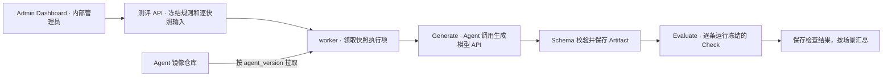
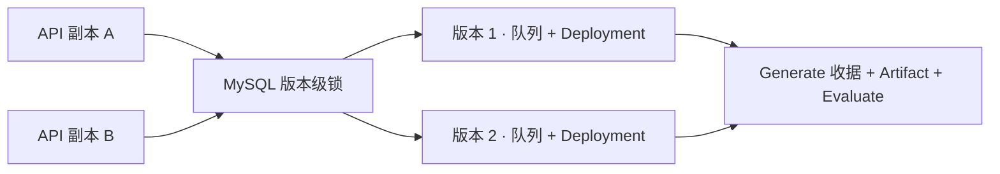
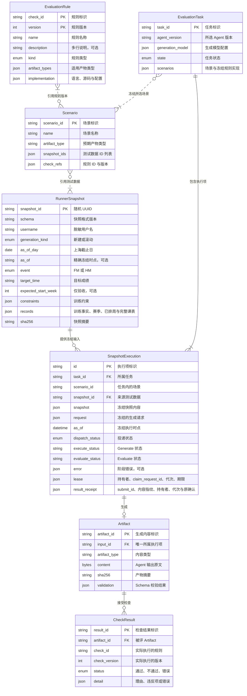

# 训练计划分布式离线测评平台 v1

设计草案 · 2026-11-24 · [查看架构图和实体属性图](2026-11-23-plan-eval-diagrams.html)

一个 **EvaluationTask** 用一个 Coach Agent 版本运行一个或多个 **Scenario**。场景定义产物类型，并引用跑者快照和测评规则版本。提交任务时，平台按「场景 × 快照」创建 **SnapshotExecution**。每项先生成并保存 Artifact，再逐条运行该任务冻结的测评规则。

## 1. 工作台与分布式服务

v1 测评工作台实现在现有 [Admin Dashboard](https://github.com/zhaochy1990/stride-devops/tree/master/admin-dashboard) 内，供内部管理员使用。侧栏的「训练计划」下进入「训练计划测评」，复用现有布局、导航和登录。工作台默认打开测评任务列表。 [工作台接入工单](https://github.com/zhaochy1990/stride-devops/issues/1056)

Dashboard 使用现有管理员 Bearer，经同源 `/api/admin/plan-eval/*` 路由访问独立测评 API。测评 API 在服务端复用 Admin JWT 验证口径，要求管理员 audience 和 `admin` 角色。Dashboard 的 Vite、本地 nginx 和生产 Caddy 配置对该路径使用专用转发，优先于 Dashboard 站点的 `/api` 默认转发。worker 的领取、续租和回传走独立的内部身份与路由。存储仍使用专属测评库。

| 工作台入口 | 用户操作 |
|---|---|
| 测评任务 | 点击任务 ID 进入详情，按场景查看每份快照的 Generate、Artifact 和 Evaluate，打开详情或导出报告 |
| 场景库 | 新建、导入和编辑场景。选择预期 Artifact 类型、测试数据和规则版本，切换快照查看对应的只读生成请求 JSON |
| 测试数据 | 新建、导入和编辑脱敏的 RunnerSnapshot。列表按数据 ID、用户名、项目、目标成绩、生成类型、数据截止日展示，点击数据 ID 进入结构化详情，再进入编辑。同一份数据可供多个场景使用 |
| 测评规则 | 新建、试跑和发布规则版本。点击名称打开指定版本，编辑规则实现或多行说明后保存为新版本 |

### 提交、Generate、Evaluate

1. **提交。** 用户选择一个 Agent 版本、多选或全选场景，填写 worker 副本数和所需的镜像环境变量，然后一键启动。测评 API 校验引用并在同一事务中保存任务和待投递的执行项。任一场景不存在、配置无效或缺少有效快照，整次提交返回错误。重试同一提交时按幂等键取回原 task_id。
2. **Generate。** 调度器按 Agent 版本投递消息并启动或复用对应 worker。worker 按消息中的执行项 ID 领取完整的冻结输入，用该跑者快照响应 Agent 的数据工具调用，按本项生成请求运行所选版本并调用生成模型 API。工作台支持手动调整并发，生成结束后启动清理。详见 [调度与接管](https://github.com/zhaochy1990/stride-devops/issues/1046)。
3. **保存 Artifact。** worker 按预期类型执行 Schema 校验，保存 Artifact 原文、摘要和校验结果。有效产物的持久化与执行项切换到可评分状态在同一事务提交，提交成功后才进入 Evaluate。输出格式无效时保留原文和校验错误，模型调用失败且无输出时记录 Generate 错误。这两种情况均跳过该执行项的 Evaluate，其他执行项继续。
4. **Evaluate。** 运行器从任务读取冻结的规则版本和实现，逐条构造 Check，使用已保存的 Artifact、跑者快照和生成请求进行检查。v1 运行固定规则。LLM as Judge 复用同一接口，作为后续扩展。
5. **接管与汇总。** 每个快照执行项有独立租约，API 拒绝过期租约写回。Artifact 保存前中断可能再次调用生成模型，保存后接管者恢复未完成的检查。打开或导出报告时，API 按 task_id 读取明细并汇总。

独立测评 MySQL 保存规则、场景、测试数据和任务明细，Go API 的 storage 层负责写入。worker 通过内部 API 领取、续租和提交。测评环境独立于生产数据库和在线计划生成服务。



## 2. 输入与 Artifact

工作台提交明确的 `scenario_ids` 数组。全选覆盖当时整个场景库，包括其他分页。API 拒绝空数组、重复 ID 和无效 ID。后续新增场景会出现在下次全选中。

工作台每次发起测评生成一个 `Idempotency-Key`。网络重试沿用该键，主动重测生成新键。相同提交者用同一键提交相同参数时返回原任务，携带不同参数返回 HTTP 409。Agent 镜像环境变量值用于启动 worker，报告只展示变量名。

```json
{
  "agent_version": "example-v2",
  "replicas": 2,
  "environment": {"LOG_LEVEL": "info"},
  "scenario_ids": ["new-season", "rolling"]
}
```

场景导入引用已存在的测试数据和规则版本。以下场景选了两份快照，并对每份产物运行同一个固定规则版本。

```json
{
  "scenario_id": "new-season",
  "name": "新建赛季",
  "artifact_type": "master_plan",
  "snapshot_ids": ["297eea13-0966-4bab-9960-837919452738", "42c1b52b-c092-40a7-b659-c4f927fe3cf3"],
  "check_refs": [{"check_id": "weekly-run-days", "version": 1}]
}
```

RunnerSnapshot 在「测试数据」独立维护，运行时 JSON 使用 `schema: "plan-eval-runner-snapshot/v1"` 标识格式。导入时校验快照结构，任务提交时再按所选场景和产物类型校验必要输入。配置错误定位到场景、快照和字段。校验通过后，在同一事务写入任务的冻结规则与各条执行项的数据包。

| 快照部分 | 内容 |
|---|---|
| 基础信息 | 脱敏标识、显示名、生成类型和上海数据截止日 |
| 生成输入 | 比赛目标、训练可用性和生成路径所需的约束，沿用 Coach Agent 的请求字段 |
| 跑者历史 | Provider 读取的结构化档案、逐条活动、比赛成绩、校准及覆盖信息，区分未覆盖、缺测和已覆盖但无记录 |
| 滚动输入 | 已启用的赛季计划及其政策包、已排周记录和已有完整周课表 |

新建和导入快照时由平台生成随机 UUID 作为 `snapshot_id`，编辑时保留原 ID。列表空间不足时缩略显示，详情页展示完整 UUID。用户名读取 `username`，项目和目标成绩读取 `event` 与 `target_time`。`generation_kind` 的 `new_season` 对应新建赛季，`rolling_continue` 对应到期接续，`rolling_catch_up` 对应漏排追赶。

生成请求按所选产物类型和快照构造，场景页提供只读请求 JSON，切换快照可核对各份生成输入。新建赛季使用 `MasterPlanGraphRequest`，滚动排课使用 `RollingJobRequest`。每条 SnapshotExecution 保存本次实际使用的请求、快照内容和冻结执行时点。`request_id` 随执行项固定，重试和接管沿用。滚动的实际起始周由 Agent 根据已排周记录和执行时点推导，规则预期起始周由 Evaluate 读取。

产物统一保存为 **Artifact**。v1 的 `master_plan` 包含赛季计划和首批周课表，`weekly_plan_batch` 包含赛季 ID、实际生成起止周与该批完整周课表。Evaluate 对两类产物都通过 `artifact.weekly_docs` 访问周课。

#### Worker 冻结读面与产物线上契约（#1053）

- 滚动读取 `records.active_master_plan`（沿用 `planId/revision/status/content`）、`records.weekly_plan_weeks`（`{week_start, master_plan_id, revision}` 数组）与 `records.weekly_plans`（`{week_start, content}` 数组，content 为完整 `weekly-plan/v1`）。后两字段可在新建快照中省略；滚动必需，空集合须显式 `[]`，已排周记录缺对应完整周课表时 Generate 记录具体周缺口，不连接生产服务。
- `as_of` 固定为同一上海截止日内的执行时点。快照可选 `as_of` 声明所有 records 已在该精确时点冻结；缺省只声明日末覆盖，日内读取当日无时间戳的负荷、恢复、比赛、PB 或校准时必须报告覆盖缺口，不把整日数据当作早间已知数据。新建请求的 `requested_as_of` 和滚动请求的 `as_of` 必须与该时点一致；省略时由 Worker 注入。工具的活动、赛季和课表读面始终来自同一跑者快照；同日活动还按原始时间戳截到 `as_of`，不可读到执行时点后开始或尚未结束的活动。
- 新建按 `MasterPlanGraphRequest` 运行本镜像 master kernel；滚动按 `RollingJobRequest` 复用生产 handler 的读档、`fromStoredContent`、周界推导和 `runRollingProjection`，仅将生产写入通道换为执行项内的产物捕获。`expected_start_week` 是可选验收值，Generate 不读取。全马 C、D 使用 2026-10-05 起算的同一赛季与 2026-10-26 时点，已排末周分别 4/2，实际起始周分别 5/4；追赶不生成截至执行日的课。
- 滚动 Artifact 形状为 `{type:"weekly_plan_batch", master_plan_id, window:{start_week,end_week,mode}, weekly_docs}`，`mode` 为 `boundary` 或 `catch_up`。范围描述最终可发布周（剔除过去日期后），SchemaCheck 检查完整周契约、周号连续性和范围内周数。新建仍为 `{type:"master_plan",plan,weekly_docs}`，赛季及周课契约不另建副本。
- 半马不在测评入口做版本能力预筛。半马新建与 1:20 滚动交给本镜像真实内核；版本不支持、必要输入缺口、非完成终态及模型故障均回传结构化 Generate 错误；真实内核模型重试耗尽后采用模板兜底的输出在测评中记为 `model_generation_failed` 并保留最近的模型调用错误或输出校验失败原因，不冒充模型成功 Artifact（生产兜底行为不改），由 API 保留 Evaluate 跳过状态，不阻断其他执行项。滚动无可发布新课时回传 `kernel_rolling_no_op`，不伪造空 Artifact。
- 本票以 Worker 公开交接及现有真实滚动内核的离线测试验收；已发布镜像、八份真实样本和隔离网络 E2E 由波后统一派发，不以模型测试桩替代镜像验收。

### 测试数据详情

| 区域 | 展示内容与来源 |
|---|---|
| 跑者与目标 | 完整快照 ID、脱敏用户名、比赛项目、目标成绩、比赛日期、生成类型和上海截止日。新建赛季的目标与训练可用性对应 [MasterPlanGraphRequest](../../../src/coach_contract/src/master_plan/contracts.ts#L72) 的 `goals` 和 `availability` |
| 训练可用性 | 每周跑步日上限、可用时段、禁训日、单课时长上限和力量训练次数。滚动路径从已启用赛季计划的 `content.availability` 读取自身约束 |
| 跑者历史 | 根据 [ContextSnapshotSchema](../../../src/coach_agent/src/graph/master_plan/context.ts#L48) 显示档案、近期与长期训练汇总、比赛、PB、校准、恢复和伤病。逐条活动单列记录数与日期范围，按 Provider 的 `shanghaiDay` 展示。单列历史回填和历史指标覆盖，区分部分覆盖、缺测、未覆盖与无记录 |
| 滚动排课输入 | 展示已有赛季计划 ID、课表归属计划 ID、状态与起始日，以及阶段策略、负荷骨架和锚点的覆盖。已排周记录（`week_start`）和完整周课表独立展示。[`RollingJobRequest.master_plan_id`](../../../src/coach_contract/src/weekly_plan/rolling.ts#L12) 只校验 Provider 读到的计划。规则预期起始周独立展示，实际出课范围由 [滚动 handler](../../../src/coach_agent_worker/src/kernel/rolling/handler.ts#L76) 从冻结输入推导 |

详情页默认展示结构化概要，原始 JSON 可展开核对，编辑有独立入口。场景页负责展示选择场景与快照后构造的实际请求 JSON。原型示例没有上传的历史和计划应显示缺测或未覆盖。请求预览保留已录入的训练可用性，缺失字段使用演示默认值。正式运行时，导入和任务提交按生成路径校验真实输入，保留具体缺失字段与工具所需数据；可选缺测按快照原值保存。

### 测评 API 与 worker 交接

[测评 API 与冻结输入契约实施工单](https://github.com/zhaochy1990/stride-devops/issues/1055)负责快照导入、冻结和这组内部接口。

API 使用测评 MySQL 中按数据库和 Agent 版本命名的连接级锁，协调同版本的提交、启动、扩缩容与清理。多个 API 副本遵守同一锁，锁连接失效时取消运行操作。测评库为每个版本记录递增的运行代次，Deployment 和启动 Secret 保存代次，已有对象拒绝更旧的命令。扩缩容只更新已有 Deployment。清理确认队列空闲后，在测评库同一事务内再次检查活跃 Generate 并保存清理意图。有待完成的清理时，提交和扩缩容返回可重试的冲突。清理复查队列，按 Kubernetes UID 和 resourceVersion 删除资源，等前台删除结束后清除启动凭据并保留代次。清理中断后可以重试同一意图。新提交随后以新启动配置重建 Deployment。环境变量留空时沿用有效配置。副本数省略或为 0 时沿用有效副本数，首次默认 1。管理员通过 `POST /api/admin/plan-eval/agent-versions/{version}/scale` 提交 `{"replicas": 3}` 调整版本的共享并发。副本数为 1–配置上限，期望副本数先保存，集群故障后可重试。



API 按版本协调任务提交与启动。若该版本已有正在运行或尚待启动的配置，留空沿用已冻结的环境变量，配置冲突在创建任务前返回。有效启动配置、任务和待投递执行项在同一提交事务中持久化。事务成功后，API 确保版本队列存在、发布待投递项并启动或复用 Deployment。RabbitMQ 消息只携带协议版本和执行项 ID。

```json
{"schema_version": 1, "snapshot_execution_id": "input-a"}
```

| 操作 | 请求与行为 |
|---|---|
| 领取 Generate | worker 发送 `snapshot_execution_id`、`agent_version`、`worker_id` 和 `claim_request_id`（每条处理流程生成，网络重试沿用）。API 鉴别 worker 身份并校验版本，在有效租约内，同一领取请求可取回原租约。新领取返回租约代次、期限、预期产物类型、冻结执行时点、完整快照和生成请求。已有其他有效租约时返回可重试时间，Generate 已终结时返回持久化结果摘要 |
| 续租 | worker 提交执行项 ID，JSON 包含 `agent_version`、`worker_id`、`lease_epoch`。API 按服务端时间检查版本、持有者、代次与期限，再延长有效租约；已到期租约不能通过续租复活。接管仅在原租约失效后发生，服务端递增代次 |
| 提交 Generate 结果 | worker 提交执行项 ID，JSON 包含 `agent_version`、`worker_id`、`lease_epoch`、`submit_id`（本次生成固定）和 `result`，回传 Artifact 原文字节及 Schema 校验结果，或结构化生成错误。相同持有者和代次、提交 ID 及内容指纹重发时返回原确认（即使租约随后到期）。新提交 ID 或不同内容返回 `result_conflict`，旧持有者/代次返回 `stale_lease`。不同内容冲突或旧租约试图提交新结果时，API 保留已持久化结果 |

worker 领取后一次获得完整冻结数据包，使用本条执行项的只读 Provider 响应多次工具调用。必需数据缺测的错误记录工具名和缺少的数据。目标版本的半马生成错误沿用相同回传接口。同批其他执行项可继续运行。

领取返回租约占用时，worker 保持当前消息未确认，按服务端可重试时间有界退避后再次领取。连接中断时由 RabbitMQ 重投。生成结果持久化成功或 API 确认 Generate 已终结后，worker ACK 消息。租约记录持有者与领取请求 ID。终态收据记录提交 ID、内容指纹及原确认，与 Generate 终态、Artifact（如有）和下一步 Evaluate 状态同事务提交，跨 API 副本复用。Schema 校验失败留存原文并跳过 Evaluate。Evaluate 每完成一条规则就持久化该结果，接管时读取已保存的 Artifact，仅运行本任务尚无结果的冻结规则。保存时校验本轮 Evaluate 租约期限，过期或被接管的运行器不能提交或结束新一轮 Evaluate。

API 按 RabbitMQ 发布确认保存执行项的 `dispatched_at`。重试只投递尚未确认且 Generate 未终结的执行项；确认丢失时可再次投递。发布或启动失败时展示失败阶段，用户在原任务上重试，沿用原任务和执行项 ID。确认丢失可再次投递，Generate 已终结的执行项由领取接口返回原结果。浏览器网络重发沿用提交幂等键，主动重测使用新键。首批八份数据固化后，用实测包体和耗时决定是否拆出大数据拉取。 [调度与接管决议](https://github.com/zhaochy1990/stride-devops/issues/1046#issuecomment-7095462890) · [worker 执行契约](https://github.com/zhaochy1990/stride-devops/issues/1047#issuecomment-7095113843)

## 3. 测评规则存储与 Check 接口

**EvaluationRule** 独立存储规则版本，以 `(check_id, version)` 为主键。每版保存名称、可选多行说明、适用产物类型、规则类型和实现配置。v1 的固定测评规则使用 JavaScript 的 `run(input)`，版本记录保存 JavaScript 源码及配置。规则试跑与批量 Evaluate 调用同一个服务端隔离运行器。运行器读取只读的冻结输入。规则以 `input.as_of` 为时点，运行器固定默认时钟并禁用未冻结的随机源，使试跑和批量执行使用等价环境。限制执行时间与内存，并校验返回的 `CheckResult`。规则执行权限限于输入数据和计算。原型使用 QuickJS，正式隔离引擎由实施验证选定。 [JavaScript 规则实施工单](https://github.com/zhaochy1990/stride-devops/issues/1057)

```json
{
  "check_id": "weekly-run-days",
  "version": 1,
  "name": "每周跑步日上限",
  "description": "同一天多次跑步计为一个跑步日。",
  "kind": "rule",
  "artifact_types": ["master_plan", "weekly_plan_batch"],
  "implementation": {
    "language": "javascript",
    "source": "function run(input) {\n  const expected = input.snapshot.constraints.max_run_days_per_week;\n  if (!Number.isInteger(expected)) {\n    return {status: \"error\", error: {code: \"rule_input_missing\", message: \"快照缺少每周跑步日上限。\"}};\n  }\n  const violations = input.artifact.weekly_docs.flatMap(week => {\n    const actual = new Set(week.sessions.filter(session => session.kind === \"run\").map(session => session.date)).size;\n    return actual > expected ? [{week_name: week.week_name, expected, actual}] : [];\n  });\n  return violations.length\n    ? {status: \"fail\", reason: \"存在超出跑步日上限的周。\", violations}\n    : {status: \"pass\", reason: \"各周均符合跑步日上限。\"};\n}"
  }
}
```

场景通过 `check_refs` 选择具体版本，同一场景内每个规则 ID 只选一次。多个场景可以引用同一版本。修改规则时保存新版本，场景选中该版本后，新任务使用新定义。提交测评时，API 校验版本存在且适用于场景产物，将完整的实现、配置和版本写入任务的 `scenarios[].checks`。

```ts
interface Check<A = CheckedArtifact> {
  run(input: CheckInput<A>): Promise<CheckResult>;
}

type RawArtifact = Readonly<{
  type: "master_plan" | "weekly_plan_batch";
  content: Uint8Array;
}>;

type CheckedArtifact =
  | {type: "master_plan"; plan: MasterPlan; weekly_docs: readonly WeeklyPlan[]}
  | {
      type: "weekly_plan_batch";
      master_plan_id: string;
      window: {start_week: number; end_week: number; mode: "boundary" | "catch_up"};
      weekly_docs: readonly WeeklyPlan[];
    };

type FrozenGenerationRequest = MasterPlanGraphRequest | RollingJobRequest;

type CheckInput<A = CheckedArtifact> = Readonly<{
  artifact: A;
  snapshot: RunnerSnapshot;
  scenario: Readonly<{
    scenario_id: string;
    request: FrozenGenerationRequest;
  }>;
  as_of: string;
}>;

type CheckResult =
  | {status: "pass"; reason: string}
  | {status: "fail"; reason: string; violations: readonly Violation[]}
  | {status: "error"; error: {code: string; message: string}};
```

- **StaticRuleCheck** 从每份冻结的规则配置构造实例。新增规则通过配置生效，共用运行时。每周跑步日上限规则按上海日期去重，超限时返回具体周、预期上限和实际天数。
- **SchemaCheck** 实现 `Check<RawArtifact>`，在 Generate 阶段使用现有契约检查原文。Evaluate 的业务检查使用 `Check<CheckedArtifact>`，接收已通过 Schema 校验的结构化产物。业务检查使用与 Generate 一致的冻结执行时点。
- **LlmJudgeCheck** 预留给后续版本，使用提示词与评审模型配置，沿用统一输入和结果接口。v1 的固定规则结果展示通过、不通过或执行错误。

运行器逐条调用 Check。单条规则不通过时记录原因和违反项，执行异常时记录错误码与消息，其余规则继续执行。 API 保存结果时关联 Artifact，并记录实际执行的规则 ID 和版本。首批规则与正反例见 [固定规则检查决策](https://github.com/zhaochy1990/stride-devops/issues/1049)。

## 4. 报告格式与界面状态

报告是任务的只读汇总视图。页面和 JSON 导出读取同一份任务、冻结输入、Artifact 和 CheckResult。快照与产物可通过 SHA-256 核对完整性。报告记录实际运行的规则 ID 与版本。下例中，一位跑者产物通过 Schema 校验但规则不通过，另一位跑者生成超时。

```json
{
  "schema": "plan-eval-report/v1",
  "task_id": "task-001",
  "agent_version": "example-v2",
  "status": "error",
  "summary": {"pass": 0, "fail": 1, "error": 1},
  "scenarios": [{
    "scenario_id": "new-season",
    "status": "error",
    "summary": {"pass": 0, "fail": 1, "error": 1},
    "inputs": [
      {
        "id": "input-a",
        "snapshot_id": "297eea13-0966-4bab-9960-837919452738",
        "status": "fail",
        "generate": {"status": "pass", "artifact_id": "art-a", "artifact_type": "master_plan"},
        "evaluate": {
          "status": "fail",
          "artifact_id": "art-a",
          "checks": [{
            "check_id": "weekly-run-days",
            "check_version": 1,
            "status": "fail",
            "detail": {
              "reason": "安排了 5 个跑步日，上限为 4 天。",
              "violations": [{"week_name": "第 1 周", "expected": 4, "actual": 5}]
            }
          }]
        }
      },
      {
        "id": "input-b",
        "snapshot_id": "42c1b52b-c092-40a7-b659-c4f927fe3cf3",
        "status": "error",
        "generate": {
          "status": "error",
          "artifact_id": null,
          "error": {"code": "generation_model_timeout", "message": "生成模型调用超时。"}
        },
        "evaluate": {"status": "skipped", "artifact_id": null, "checks": []}
      }
    ]
  }]
}
```

`queued` 与 `running` 表示进行中。Generate 的无效产物记 `fail`，基础设施或模型故障记 `error`，两种情况的 Evaluate 均为 `skipped`。有效产物评分时，Evaluate 与 Generate 引用同一个 Artifact。执行项结束后，按 `error > fail > pass` 汇总，`skipped` 保留前序失败。场景按执行项计数，任务累加各场景计数。

## 5. 场景引用与任务冻结

提交任务时，API 将所选场景直接写入 `EvaluationTask.scenarios`。每项包含场景 ID、名称、产物类型和完整的规则版本配置。每份快照则创建独立的 SnapshotExecution，保存所属场景 ID、来源快照 ID、冻结快照内容、生成请求、执行时点和投递状态。Generate 读取该执行项的输入，Evaluate 通过 `task_id` 和 `scenario_id` 定位任务内的冻结规则。

例如，一个场景绑定规则 v1 和快照 A。场景后来切换到 v2，测试数据也更新了快照 A。已提交的任务继续用 v1 的源码和旧快照，新提交的任务才读取更新后的引用和数据。两个场景同时引用快照 A 时，各创建一条执行项，分别使用所属场景的规则。



虚线表示保存在 JSON 中的引用。Scenario 的场景库配置引用规则版本和测试数据 ID。EvaluationTask 的场景列表保存提交时展开的规则，因此 CheckResult 的规则版本可从该任务回查。

SnapshotExecution 以 `(task_id, scenario_id, snapshot_id)` 去重。每个执行项至多生成一份 Artifact，`Artifact.input_id` 唯一。CheckResult 按 `(artifact_id, check_id)` 去重，`check_version` 记录实际执行的版本。

## 6. 实现验收

| 场景 | 可验证结果 |
|---|---|
| 内部管理员通过现有 Admin Dashboard 登录 | 可通过「训练计划测评」进入任务、场景、测试数据和测评规则。测评 API 对普通用户和匿名请求拒绝访问 |
| 用相同冻结输入试跑并批量运行同一条 JavaScript 规则 | 两个入口使用同一个隔离运行器与同一份 Check 接口，含时间判断的规则也基于同一冻结时点得到一致判定。超时或返回值不合法的规则记录执行错误，其余规则继续 |
| 新建并试跑带多行说明的测评规则，从两个场景引用 v1 | 保存一份可复用的版本配置，两个场景均可选中该版本，打开版本详情可回读说明和实现 |
| 修改规则并将其中一个场景切换到 v2 | 新任务分别读取两个场景选定的版本。在版本切换前已提交、尚未被 worker 领取的任务仍执行 v1 的冻结实现 |
| 两个场景共用一份跑者快照 | 创建一个任务和分别归入两个场景的执行项。每项使用实际产物类型对应的请求及所属场景的检查 |
| 新建和导入测试数据 | 每份数据自动获得一个随机 UUID。列表首列显示 ID 并可进入详情，随后独立展示用户名、项目、目标成绩、生成类型和数据截止日 |
| 打开新建和滚动两类测试数据详情 | 两类都能查看目标、约束、数据截止日与历史覆盖。滚动额外展示 Provider 提供的计划、已排周记录和完整周课表，并独立标明规则预期起始周。可展开原始 JSON、编辑并通过原 ID 回读 |
| 导入快照并加入场景，或编辑已引用数据 | 新任务使用当前快照和请求。历史任务的快照内容、请求和执行项数量可原样回读 |
| 全选跨页场景后提交，再新增场景 | 已提交任务保留原场景清单。下次全选包含新增场景 |
| 提交空清单、重复 ID、不适用的规则版本或无效引用 | API 返回具体配置错误，测评库无部分任务，worker 未启动 |
| 网络重试和主动重测 | 相同幂等键及参数取回原任务。相同键、不同参数返回 409。主动重测创建新任务 |
| 同一场景选择两个 Agent 版本分别测评 | 两个任务分别保存所选版本，worker 使用对应 Agent，报告可分别打开 |
| 一份真实脱敏全马快照，生产数据服务不可达 | 从工作台发起任务，目标版本 worker 领取完整冻结数据包，多次取数来自同一快照，保存 Artifact 后开放固定规则检查 |
| 发布确认丢失或版本 Deployment 启动失败 | 原任务可重试启动，任务与执行项 ID 稳定，确认完成的消息不再发布，确认丢失允许重投并复用已终结结果 |
| 同版本已有运行或待启动的配置，提交不同环境变量 | 返回冲突，版本下的待投递执行项数量保持原值。留空时复用冻结配置，已有 worker 使用同一配置读取该版本的消息 |
| 消息重投时上一份租约仍有效 | 投递保持未确认，worker 有界等待后再领取。只有接管成功后才继续生成，读取终态后确认消息 |
| 保存成功但响应丢失，或 worker 退出后租约过期 | 重发同一提交只保存一份 Artifact。过期租约可被接管，旧租约的不同提交无法覆盖新结果 |
| 生成超时或产物 Schema 校验失败 | 本项跳过 Evaluate，保留错误或无效 Artifact 原文，其他快照正常继续 |
| 一条规则不通过或出错，或者 Artifact 保存后 worker 中断 | 保留逐项理由、预期和实际值或错误，其他规则继续。接管只恢复未完成的检查 |

### 调度/恢复上线与隔离验证（devops#1061）

- 新增列由测评 API 的 `AutoMigratePlanEval` 创建：`plan_eval_executions.dispatched_at/claim_request_id` 及 `plan_eval_receipts.submit_id/fingerprint/worker_id/lease_epoch`；任务 `params_fingerprint` 扩为 128 字符容纳 v2 标记，旧任务默认副本指纹仍可重放、新任务区分省略与显式副本数；不迁移或访问生产运动数据。历史报告和已终结执行项保留，老收据仍可通过终态领取 ACK。
- Deployment 注入的内部 worker token 由测评 API 根密钥按 Agent 版本签名派生，API 校验凭据版本与请求版本一致；根密钥不下发 worker。内部 worker 契约新增持有者、领取 ID 与提交 ID，须使用包含本契约的 worker 镜像。升级前先让旧版 Generate 排空并清理 Deployment，再升级 API/worker；旧镜像不支持新增必填字段，不应作为本版可运行版本登记。部署 pin PR 仍由用户审批。
- 测评 API 需要 MySQL `GET_LOCK`/`RELEASE_LOCK`，锁在专用连接上持有并按数据库隔离，连接池至少需要锁连接和业务连接。已有 K8s 对象通过运行代次和 resourceVersion 拦截旧请求。创建缺失对象前重新确认启动配置身份、运行代次和清理状态。生成队列使用 classic 类型。不可路由发布不会标记为已投递。未知队列类型或缺少实时总数时拒绝清理。
- CI 的既有 MySQL 测评步骤覆盖原任务重试、双版本扩缩容/清理竞争、领取响应丢失、身份/过期续租、终态指纹冲突和逐规则恢复；真实 RabbitMQ 门禁测试通过 `PLAN_EVAL_TEST_AMQP_URL` / `PLAN_EVAL_TEST_MANAGEMENT_URL` 启用，沿用 `STRIDE_WORKER_TEST_MYSQL_DSN` 的隔离数据库。
- 本票不占用共用本地 E2E 栈。独占容器验证 RabbitMQ 实际未确认投递、回传确认丢失、终态重投 ACK 与保留队列/报告；真实目标镜像、工作台浏览器及 Kubernetes 波后 E2E 由 master 派发。

测评 MQ 继续使用 devops 原生测评服务账号，worker 属于受信任的内部服务；HTTP 版本凭据隔离不等价于 RabbitMQ 账号级隔离。本票不新增 RabbitMQ 用户/权限管理，账号级恶意消费者隔离需要单独的部署授权与账号管理变更。

## #1056 批量控制面（实施接口）

管理员同源前缀 `/api/admin/plan-eval` 新增：

| 接口 | 行为 |
| --- | --- |
| `GET/POST /scenarios`、`GET/PUT /scenarios/{id}` | 场景名称、`artifact_type`、`snapshot_ids`、`rules: [{id, version}]`；新建分配 UUID，保存/提交验证所有引用 |
| `GET/POST /snapshots`、`GET/PUT /snapshots/{id}` | RunnerSnapshot/v1 完整 JSON；新建/导入忽略文件 ID 并分配 UUID，编辑保留路径 ID；列表只读摘要列 |
| `POST /request-preview` | `{artifact_type, snapshot_id, request}` → 只读 `{request, as_of}`，与提交共用校验与组装，不写入任务 |
| `GET /rules` | 已发布规则只读列表；规则发布/试跑归 #1057 |
| `POST /tasks` | 新增 `scenario_ids` 明确清单；`[]` 拒绝，省略兼容旧 preset 单样本客户端。幂等键在读取可变引用前查重 |
| `GET /tasks/{id}` | `scenarios`、按 `scenario_id` 归属的执行状态、冻结时点与 `frozen_rules`；保留旧 `scenario` 首项字段 |
| `GET /tasks/{id}/executions/{execution_id}/input` | 读取该任务执行项的冻结 `snapshot`、`request` 与 `as_of`，由详情展开时按需请求 |

新建赛季请求以所选快照的 `records.race_target`、`event`、`target_time`、`constraints` 填充目标、跑步日上限与禁训日；其余 intake 沿用场景 request 模板，空模板复用已发布 preset 的全日窗口、无力量课与空约束数组，不伪造运动历史。生成时点优先使用快照 `as_of`（必须归属同一上海截止日），缺省固定为上海数据截止日末 `23:59:59+08:00`。滚动请求仅含 `request_id`、active 行 `master_plan_id` 与 **`as_of`**；不含 `requested_as_of` 或规则预期起始周。

滚动输入另要求 `records.active_master_plan`、`records.weekly_plan_weeks` 和 `records.weekly_plans`。赛季计划须覆盖上海截止日，跑步可用度明细须符合滚动生成契约。已排周记录须有同日起始的完整周课表。两个集合的空数组表示已记录但无数据。`expected_start_week` 仅供详情及检查使用。

独立测评库启动时由 AutoMigrate 增加 `plan_eval_tasks.scenarios_json`、`plan_eval_frozen_rules.scenario_id` 与 `plan_eval_executions.snapshot_name`。新任务在原事务中冻结场景清单、快照、请求、场景规则和脱敏跑者名。同一任务内各场景共用同一份快照内容。已有单样本任务兼容空规则归属和历史幂等参数指纹，并从原始冻结快照展示跑者名。preset 仅首次初始化。

新任务的 v3 指纹按排序后的场景清单计算。省略副本数的请求沿用版本配置，重放时仍以原请求的省略值计算指纹。旧单场景 v1 指纹按默认副本数 1 匹配，v2 指纹保留省略值。

验收：本地原生依赖（独立 MySQL + API HTTP 契约、Dashboard 组件）覆盖复用快照、编辑后冻结回读、领取、错误引用整批拒绝、跨分页全选。真实 RabbitMQ/目标镜像/模型的两场景批次及首批八份由 master 在第一波全部合并后统一 E2E；本票不操作共享栈或生产 pin 审批。
