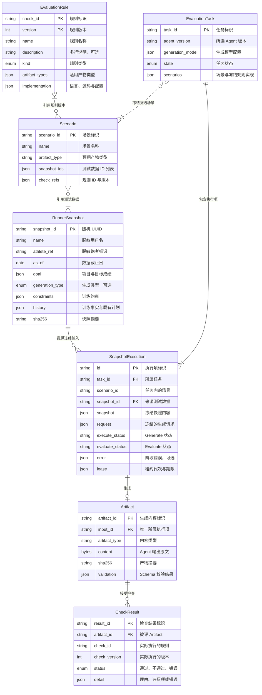

# 训练计划分布式离线测评平台 v1

设计草案 · 2026-11-24 · [查看架构图和实体属性图](2026-11-23-plan-eval-diagrams.html)

一个 **EvaluationTask** 用一个 Coach Agent 版本运行一个或多个 **Scenario**。场景定义产物类型，并引用跑者快照和测评规则版本。提交任务时，平台按「场景 × 快照」创建 **SnapshotExecution**。每项先生成并保存 Artifact，再逐条运行该任务冻结的测评规则。

## 1. 工作台与分布式服务

| 工作台入口 | 用户操作 |
|---|---|
| 测评任务 | 点击任务 ID 进入详情，按场景查看每份快照的 Generate、Artifact 和 Evaluate，打开详情或导出报告 |
| 场景库 | 新建、导入和编辑场景。选择预期 Artifact 类型、测试数据和规则版本，切换快照查看对应的只读生成请求 JSON |
| 测试数据 | 新建、导入和编辑脱敏的 RunnerSnapshot。列表按数据 ID、用户名、项目、目标成绩、生成类型、数据截止日展示，点击数据 ID 进入结构化详情，再进入编辑。同一份数据可供多个场景使用 |
| 测评规则 | 新建、试跑和发布规则版本。点击名称打开指定版本，编辑规则实现或多行说明后保存为新版本 |

### 提交、Generate、Evaluate

1. **提交。** 用户选择一个 Agent 版本、多选或全选场景，填写 worker 副本数和所需的镜像环境变量，然后一键启动。测评 API 校验引用并在同一事务中保存任务和执行项。任一场景不存在、配置无效或缺少有效快照，整次提交返回错误。重试同一提交时按幂等键取回原 task_id。
2. **Generate。** 调度器按 Agent 版本投递消息并启动或复用对应 worker。worker 领取执行项，用冻结的跑者快照响应 Agent 的数据工具调用，按本项生成请求运行所选版本并调用生成模型 API。工作台支持手动调整并发，生成结束后启动清理。详见 [调度与接管](https://github.com/zhaochy1990/stride-devops/issues/1046)。
3. **保存 Artifact。** worker 按预期类型执行 Schema 校验，保存 Artifact 原文、摘要和校验结果。有效产物的持久化与执行项切换到可评分状态在同一事务提交，提交成功后才进入 Evaluate。输出格式无效时保留原文和校验错误，模型调用失败且无输出时记录 Generate 错误。这两种情况均跳过该执行项的 Evaluate，其他执行项继续。
4. **Evaluate。** 运行器从任务读取冻结的规则版本和实现，逐条构造 Check，使用已保存的 Artifact、跑者快照和生成请求进行检查。v1 运行固定规则。LLM as Judge 复用同一接口，作为后续扩展。
5. **接管与汇总。** 每个快照执行项有独立租约，API 拒绝过期租约写回。Artifact 保存前中断可能再次调用生成模型，保存后接管者恢复未完成的检查。打开或导出报告时，API 按 task_id 读取明细并汇总。

独立测评 MySQL 保存规则、场景、测试数据和任务明细，Go API 的 storage 层负责写入。worker 通过内部 API 领取、续租和提交。测评环境独立于生产数据库和在线计划生成服务。


## 2. 输入与 Artifact

工作台提交明确的 `scenario_ids` 数组。全选覆盖当时整个场景库，包括其他分页。API 拒绝空数组、重复 ID 和无效 ID。后续新增场景会出现在下次全选中。

工作台每次发起测评生成一个 `Idempotency-Key`。网络重试沿用该键，主动重测生成新键。相同提交者用同一键提交相同参数时返回原任务，携带不同参数返回 HTTP 409。Agent 镜像环境变量值用于启动 worker，报告只展示变量名。

```json
{
  "agent_version": "example-v2",
  "replicas": 2,
  "environment": {"LOG_LEVEL": "info"},
  "scenario_ids": ["new-season", "rolling"]
}
```

场景导入引用已存在的测试数据和规则版本。以下场景选了两份快照，并对每份产物运行同一个固定规则版本。

```json
{
  "scenario_id": "new-season",
  "name": "新建赛季",
  "artifact_type": "master_plan",
  "snapshot_ids": ["297eea13-0966-4bab-9960-837919452738", "42c1b52b-c092-40a7-b659-c4f927fe3cf3"],
  "check_refs": [{"check_id": "weekly-run-days", "version": 1}]
}
```

RunnerSnapshot 在「测试数据」独立维护。每份快照包含脱敏标识、数据截止日、目标、训练约束和历史事实。滚动快照还包含当时的赛季计划与已排课表。历史数据截止日按上海日历日记录。

新建和导入快照时由平台生成随机 UUID 作为 `snapshot_id`，编辑时保留原 ID。 列表空间不足时缩略显示，详情页展示完整 UUID。列表的用户名使用脱敏显示名，项目和目标成绩分别读取 `goal.distance` 和 `goal.target_time`。生成类型通过可选的 `generation_type` 声明，`new_season` 对应新建赛季，`rolling_continuation` 对应到期接续，`rolling_catch_up` 对应漏排追赶。缺少该字段的历史数据用「—」展示。

生成请求按所选产物类型和快照构造，场景页提供只读请求 JSON，切换快照可核对各份生成输入。新建赛季使用 `MasterPlanGraphRequest`，滚动排课使用 `RollingJobRequest`。每条 SnapshotExecution 保存本次实际使用的请求与快照内容。

产物统一保存为 **Artifact**。v1 的 `master_plan` 包含赛季计划和首批周课表，`weekly_plan_batch` 包含起止周与该批周课表。Evaluate 对两类产物都通过 `artifact.weekly_docs` 访问周课。

### 测试数据详情

| 区域 | 展示内容与来源 |
|---|---|
| 跑者与目标 | 完整快照 ID、脱敏用户名、比赛项目、目标成绩、比赛日期、生成类型和上海截止日。新建赛季的目标与训练可用性对应 [MasterPlanGraphRequest](../../../src/coach_contract/src/master_plan/contracts.ts#L72) 的 `goals` 和 `availability` |
| 训练可用性 | 每周跑步日上限、可用时段、禁训日、单课时长上限和力量训练次数。滚动路径从已启用赛季计划的 `content.availability` 读取自身约束 |
| 跑者历史 | 根据 [ContextSnapshotSchema](../../../src/coach_agent/src/graph/master_plan/context.ts#L48) 显示档案、近期与长期训练汇总、比赛、PB、校准、恢复和伤病。逐条活动单列记录数与日期范围，按 Provider 的 `shanghaiDay` 展示。区分未覆盖、明确缺测以及已记录的空集合 |
| 滚动排课输入 | 展示已有赛季计划 ID、状态与起始日、阶段策略、负荷骨架和锚点的覆盖，以及已经生成的周课表。[`RollingJobRequest.master_plan_id`](../../../src/coach_contract/src/weekly_plan/rolling.ts#L12) 只校验 Provider 读到的计划。规则预期起始周独立展示，实际出课范围由 [滚动 handler](../../../src/coach_agent_worker/src/kernel/rolling/handler.ts#L76) 从冻结输入推导 |

详情页默认展示结构化概要，原始 JSON 可展开核对，编辑有独立入口。场景页负责展示选择场景与快照后构造的实际请求 JSON。原型示例没有上传的历史和计划应显示缺测或未覆盖。正式运行时，导入和任务提交按生成路径校验真实输入，保留具体缺失字段与工具所需数据；可选缺测按快照原值保存。

## 3. 测评规则存储与 Check 接口

**EvaluationRule** 独立存储规则版本，以 `(check_id, version)` 为主键。每版保存名称、可选多行说明、适用产物类型、规则类型和实现配置。原型使用 JavaScript 的 `run(input)` 实现，版本记录保存语言和源码。试跑和规则执行在隔离的 QuickJS 环境中进行，并限制执行时间和内存。正式运行语言及隔离方式待确认。

```json
{
  "check_id": "weekly-run-days",
  "version": 1,
  "name": "每周跑步日上限",
  "description": "同一天多次跑步计为一个跑步日。",
  "kind": "rule",
  "artifact_types": ["master_plan", "weekly_plan_batch"],
  "implementation": {
    "language": "javascript",
    "source": "function run(input) {\n  const expected = input.snapshot.constraints.max_run_days_per_week;\n  if (!Number.isInteger(expected)) {\n    return {status: \"error\", error: {code: \"rule_input_missing\", message: \"快照缺少每周跑步日上限。\"}};\n  }\n  const violations = input.artifact.weekly_docs.flatMap(week => {\n    const actual = new Set(week.sessions.filter(session => session.kind === \"run\").map(session => session.date)).size;\n    return actual > expected ? [{week_name: week.week_name, expected, actual}] : [];\n  });\n  return violations.length\n    ? {status: \"fail\", reason: \"存在超出跑步日上限的周。\", violations}\n    : {status: \"pass\", reason: \"各周均符合跑步日上限。\"};\n}"
  }
}
```

场景通过 `check_refs` 选择具体版本，同一场景内每个规则 ID 只选一次。多个场景可以引用同一版本。修改规则时保存新版本，场景选中该版本后，新任务使用新定义。提交测评时，API 校验版本存在且适用于场景产物，将完整的实现、配置和版本写入任务的 `scenarios[].checks`。

```ts
interface Check<A = CheckedArtifact> {
  run(input: CheckInput<A>): Promise<CheckResult>;
}

type RawArtifact = Readonly<{
  type: "master_plan" | "weekly_plan_batch";
  content: Uint8Array;
}>;

type CheckedArtifact =
  | {type: "master_plan"; plan: MasterPlan; weekly_docs: readonly WeeklyPlan[]}
  | {
      type: "weekly_plan_batch";
      window: {start_week: number; end_week: number};
      weekly_docs: readonly WeeklyPlan[];
    };

type FrozenGenerationRequest = MasterPlanGraphRequest | RollingJobRequest;

type CheckInput<A = CheckedArtifact> = Readonly<{
  artifact: A;
  snapshot: RunnerSnapshot;
  scenario: Readonly<{
    scenario_id: string;
    request: FrozenGenerationRequest;
  }>;
  as_of: string;
}>;

type CheckResult =
  | {status: "pass"; reason: string}
  | {status: "fail"; reason: string; violations: readonly Violation[]}
  | {status: "error"; error: {code: string; message: string}};
```

- **StaticRuleCheck** 从每份冻结的规则配置构造实例。新增规则通过配置生效，共用运行时。每周跑步日上限规则按上海日期去重，超限时返回具体周、预期上限和实际天数。
- **SchemaCheck** 实现 `Check<RawArtifact>`，在 Generate 阶段使用现有契约检查原文。Evaluate 的业务检查使用 `Check<CheckedArtifact>`，接收已通过 Schema 校验的结构化产物。业务检查使用与 Generate 一致的冻结执行时点。
- **LlmJudgeCheck** 预留给后续版本，使用提示词与评审模型配置，沿用统一输入和结果接口。v1 的固定规则结果展示通过、不通过或执行错误。

运行器逐条调用 Check。单条规则不通过时记录原因和违反项，执行异常时记录错误码与消息，其余规则继续执行。 API 保存结果时关联 Artifact，并记录实际执行的规则 ID 和版本。首批规则与正反例见 [固定规则检查决策](https://github.com/zhaochy1990/stride-devops/issues/1049)。

## 4. 报告格式与界面状态

报告是任务的只读汇总视图。页面和 JSON 导出读取同一份任务、冻结输入、Artifact 和 CheckResult。快照与产物可通过 SHA-256 核对完整性。报告记录实际运行的规则 ID 与版本。下例中，一位跑者产物通过 Schema 校验但规则不通过，另一位跑者生成超时。

```json
{
  "schema": "plan-eval-report/v1",
  "task_id": "task-001",
  "agent_version": "example-v2",
  "status": "error",
  "summary": {"pass": 0, "fail": 1, "error": 1},
  "scenarios": [{
    "scenario_id": "new-season",
    "status": "error",
    "summary": {"pass": 0, "fail": 1, "error": 1},
    "inputs": [
      {
        "id": "input-a",
        "snapshot_id": "297eea13-0966-4bab-9960-837919452738",
        "status": "fail",
        "generate": {"status": "pass", "artifact_id": "art-a", "artifact_type": "master_plan"},
        "evaluate": {
          "status": "fail",
          "artifact_id": "art-a",
          "checks": [{
            "check_id": "weekly-run-days",
            "check_version": 1,
            "status": "fail",
            "detail": {
              "reason": "安排了 5 个跑步日，上限为 4 天。",
              "violations": [{"week_name": "第 1 周", "expected": 4, "actual": 5}]
            }
          }]
        }
      },
      {
        "id": "input-b",
        "snapshot_id": "42c1b52b-c092-40a7-b659-c4f927fe3cf3",
        "status": "error",
        "generate": {
          "status": "error",
          "artifact_id": null,
          "error": {"code": "generation_model_timeout", "message": "生成模型调用超时。"}
        },
        "evaluate": {"status": "skipped", "artifact_id": null, "checks": []}
      }
    ]
  }]
}
```

`queued` 与 `running` 表示进行中。Generate 的无效产物记 `fail`，基础设施或模型故障记 `error`，两种情况的 Evaluate 均为 `skipped`。有效产物评分时，Evaluate 与 Generate 引用同一个 Artifact。执行项结束后，按 `error > fail > pass` 汇总，`skipped` 保留前序失败。场景按执行项计数，任务累加各场景计数。

## 5. 场景引用与任务冻结

提交任务时，API 将所选场景直接写入 `EvaluationTask.scenarios`。每项包含场景 ID、名称、产物类型和完整的规则版本配置。每份快照则创建独立的 SnapshotExecution，保存所属场景 ID、来源快照 ID、冻结快照内容和生成请求。Generate 读取该执行项的输入，Evaluate 通过 `task_id` 和 `scenario_id` 定位任务内的冻结规则。

例如，一个场景绑定规则 v1 和快照 A。场景后来切换到 v2，测试数据也更新了快照 A。已提交的任务继续用 v1 的源码和旧快照，新提交的任务才读取更新后的引用和数据。两个场景同时引用快照 A 时，各创建一条执行项，分别使用所属场景的规则。



虚线表示保存在 JSON 中的引用。Scenario 的场景库配置引用规则版本和测试数据 ID。EvaluationTask 的场景列表保存提交时展开的规则，因此 CheckResult 的规则版本可从该任务回查。

SnapshotExecution 以 `(task_id, scenario_id, snapshot_id)` 去重。每个执行项至多生成一份 Artifact，`Artifact.input_id` 唯一。CheckResult 按 `(artifact_id, check_id)` 去重，`check_version` 记录实际执行的版本。

## 6. 实现验收

| 场景 | 可验证结果 |
|---|---|
| 新建并试跑带多行说明的测评规则，从两个场景引用 v1 | 保存一份可复用的版本配置，两个场景均可选中该版本，打开版本详情可回读说明和实现 |
| 修改规则并将其中一个场景切换到 v2 | 新任务分别读取两个场景选定的版本。在版本切换前已提交、尚未被 worker 领取的任务仍执行 v1 的冻结实现 |
| 两个场景共用一份跑者快照 | 创建一个任务和分别归入两个场景的执行项。每项使用实际产物类型对应的请求及所属场景的检查 |
| 新建和导入测试数据 | 每份数据自动获得一个随机 UUID。列表首列显示 ID 并可进入详情，随后独立展示用户名、项目、目标成绩、生成类型和数据截止日 |
| 打开新建和滚动两类测试数据详情 | 两类都能查看目标、约束、数据截止日与历史覆盖。滚动额外展示 Provider 提供的计划和周课表，并独立标明规则预期起始周。可展开原始 JSON、编辑并通过原 ID 回读 |
| 导入快照并加入场景，或编辑已引用数据 | 新任务使用当前快照和请求。历史任务的快照内容、请求和执行项数量可原样回读 |
| 全选跨页场景后提交，再新增场景 | 已提交任务保留原场景清单。下次全选包含新增场景 |
| 提交空清单、重复 ID、不适用的规则版本或无效引用 | API 返回具体配置错误，测评库无部分任务，worker 未启动 |
| 网络重试和主动重测 | 相同幂等键及参数取回原任务。相同键、不同参数返回 409。主动重测创建新任务 |
| 同一场景选择两个 Agent 版本分别测评 | 两个任务分别保存所选版本，worker 使用对应 Agent，报告可分别打开 |
| 生成超时或产物 Schema 校验失败 | 本项跳过 Evaluate，保留错误或无效 Artifact 原文，其他快照正常继续 |
| 一条规则不通过或出错，或者 Artifact 保存后 worker 中断 | 保留逐项理由、预期和实际值或错误，其他规则继续。接管只恢复未完成的检查 |
